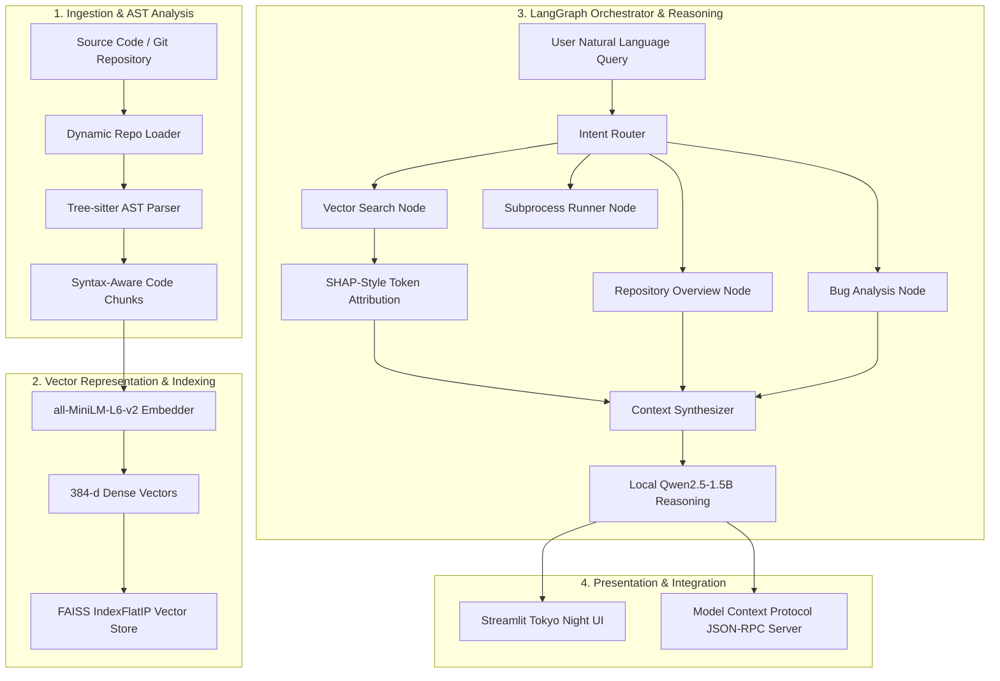

# codeAtlas: Agentic Semantic Code Search & Codebase Intelligence

**codeAtlas** is a cross-platform, private, and explainable AI engine for semantic code retrieval, multi-language repository understanding, token-level attribution, automated bug inspection, and agentic orchestration. 

Built to execute 100% locally and offline without external API keys or cloud dependencies across macOS, Linux, and Windows.

---

## Architecture Overview



---

## Key Features

- **Universal Multi-Language AST Parsing**:
  Extracts function- and class-level semantic blocks using Tree-sitter across 9 primary languages (Java, Python, JavaScript, TypeScript, Go, Rust, C, C++, and SQL), with robust line-window fallback for other file formats.
- **Dense Vector Search**:
  Embeds syntax-aware code blocks into a 384-dimensional dense semantic space via `all-MiniLM-L6-v2` and indexes them in an inner-product normalized FAISS vector database.
- **Explainable AI (Token-Level Attribution)**:
  Applies vectorized token similarity scoring to calculate individual token contributions (SHAP-style explainability), illustrating why specific code snippets matched a query.
- **Agentic Orchestration (LangGraph)**:
  Coordinates parsing, semantic retrieval, repository overview generation, bug analysis, and sandboxed test execution through a stateful `StateGraph` with conversation memory.
- **Offline Codebase Reasoning**:
  Leverages a local, quantized `Qwen2.5-1.5B-Instruct` causal language model running in bfloat16 on CPU for natural language synthesis without external network requests.
- **Model Context Protocol (MCP) Server**:
  Provides a standalone JSON-RPC 2.0 stdio interface exposing code search, indexing, and analysis tools programmatically.

---

## Quickstart

### Prerequisites
- Python 3.10, 3.11, 3.12, or 3.13
- Git (optional, for remote repository cloning)

### 1. Installation

Clone the repository and install dependencies in a virtual environment:

#### macOS / Linux
```bash
git clone https://github.com/nandinisahu2120/codeAtlas.git
cd codeAtlas/mini
python3 -m venv venv
source venv/bin/activate
pip install -r requirements.txt
```

#### Windows
```cmd
git clone https://github.com/nandinisahu2120/codeAtlas.git
cd codeAtlas\mini
python -m venv venv
venv\Scripts\activate
pip install -r requirements.txt
```

### 2. Launching the Web Interface

Use the universal cross-platform launcher:
```bash
python run.py
```

Or platform-specific scripts:
- **macOS / Linux**: `./start.sh`
- **Windows**: `start.bat`

Access the web interface at:
```text
http://localhost:8501
```

---

## Usage Guide

### 1. Indexing a Codebase
In the Streamlit chat input or agent prompt:
- **Load a remote GitHub repository**:
  ```text
  load https://github.com/username/project.git
  ```
- **Load a local directory**:
  ```text
  load /path/to/local/project
  ```
- **Re-index the active repository**:
  ```text
  index this repo
  ```

### 2. Querying & Semantic Search
Query code by functionality, concept, or technical behavior rather than exact keywords:
- `"where is user authentication handled?"`
- `"find thread safe cache operations"`
- `"language used in this repo?"`
- `"repo overview"`

### 3. Bug Analysis & Verification
- `"check math_utils.py for division by zero errors"`
- `"find bugs in the caching logic"`

---

## Model Context Protocol (MCP) Server

codeAtlas exposes its codebase analysis engine as an MCP tool server over standard I/O (stdio).

### Running the Server
```bash
python mcp_server.py
```

### Registered Tools
| Tool Name | Parameters | Description |
| :--- | :--- | :--- |
| `index_repository` | `path_or_url` | Clones/loads and indexes a GitHub URL or local directory |
| `search_code` | `query`, `top_k` | Runs dense vector search with MiniLM embeddings |
| `explain_code_match` | `query`, `code` | Computes token-level attribution and natural language explanation |
| `get_repo_overview` | *none* | Generates a manifest of indexed files, symbols, and language breakdown |
| `run_python_file` | `file_path`, `timeout` | Executes a Python file in a sandboxed subprocess |

---

## Evaluation Benchmark

The repository includes a quantitative 10-query benchmark comparing semantic vector search against keyword-based grep search across multi-language codebases.

### Running the Evaluation
```bash
python evaluation/run_eval.py
```

### Benchmark Results
| Metric | Semantic Search (codeAtlas) | Grep Baseline |
| :--- | :--- | :--- |
| **Top-1 Accuracy** | 100.0% (10/10) | 100.0% (10/10) |
| **Top-3 Accuracy** | 100.0% (10/10) | 100.0% (10/10) |
| **Search Paradigm** | Dense Vector Similarity (FAISS) | Exact Keyword Substring |
| **Explainability** | Token Attribution Contribution | None |

---

## Project Structure

```text
codeAtlas/
├── .gitignore                                           # Git ignore configuration
├── README.md                                            # Technical documentation
└── mini/                                                # Application root
    ├── run.py                                           # Universal launcher
    ├── start.sh                                         # macOS/Linux launcher
    ├── start.bat                                        # Windows launcher
    ├── config.py                                        # Global paths and configuration
    ├── mcp_server.py                                    # Model Context Protocol stdio server
    ├── requirements.txt                                 # Core dependencies
    │
    ├── agent/                                           # LangGraph agent engine
    │   ├── graph.py                                     # StateGraph coordinator & router
    │   ├── state.py                                     # AgentState TypedDict schema
    │   └── tools/                                       # Core analytical tool modules
    │       ├── parser_tool.py                           # Tree-sitter multi-language AST parser
    │       ├── indexer_tool.py                          # MiniLM embeddings & FAISS indexer
    │       ├── search_tool.py                           # Semantic search & token attribution
    │       ├── explain_tool.py                          # Local SLM reasoning (Qwen2.5-1.5B)
    │       ├── repo_loader.py                           # Dynamic GitHub & local loader
    │       └── runner_tool.py                           # Subprocess execution tool
    │
    ├── ui/                                              # Web interface
    │   └── app.py                                       # Streamlit Tokyo Night UI
    │
    ├── evaluation/                                      # Evaluation benchmark suite
    │   ├── eval_queries.json                            # 10 test query definitions
    │   └── run_eval.py                                  # Benchmark test script
    │
    ├── target_repo/                                     # Sample multi-language repository
    │   ├── apiClient.js                                 # JavaScript sample
    │   ├── auth_service.py                              # Python auth sample
    │   ├── cache.go                                     # Go concurrency cache sample
    │   ├── math_utils.py                                # Python calculation sample
    │   └── run_tests.py                                 # Sample unit test runner
    │
    └── data/                                            # Runtime cache & stores (git-ignored)
        ├── active_repo.txt                              # Active repository pointer
        ├── chunks.json                                  # Extracted AST chunks
        ├── faiss.index                                  # Serialized FAISS index
        └── metadata.json                                # Indexing metadata
```

---

## Privacy & Security

codeAtlas executes strictly on your local machine:
- No telemetry or analytical tracking.
- No outbound API calls for inference or embeddings.
- Code repositories remain within the local filesystem.
